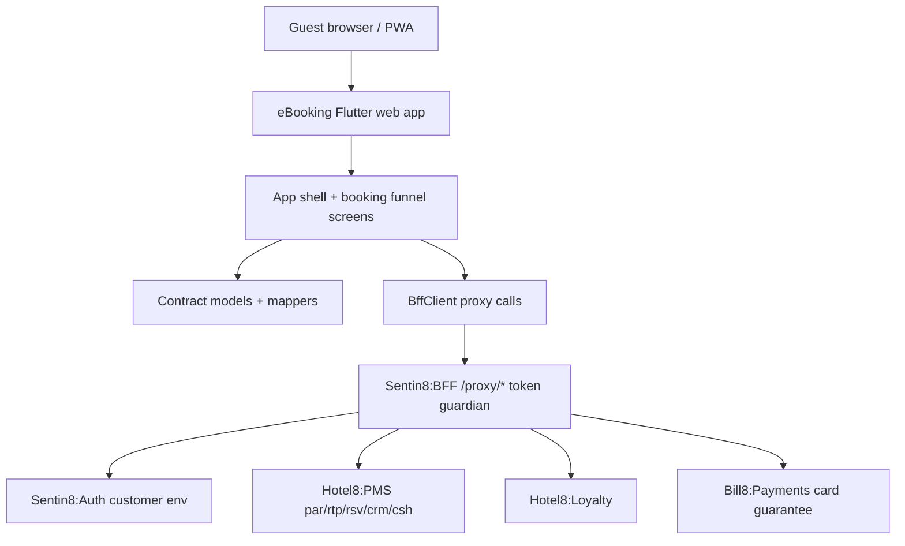

# Hotel8:eBooking

## 1. Summary

Hotel8:eBooking is a Flutter application packaged in the hotel8 vertical that
serves as the guest-facing Internet Booking Engine (IBE) - the hotel's direct
booking website. Guests search real-time availability, compare room types and
rate plans, select packages, and complete reservations, either anonymously or
signed in as loyalty members. Every client-to-backend call is proxied through
Sentin8:BFF, which brokers all tokens server-side.

## 2. Motivation

Third-party booking engines lease out the direct channel and charge
per-booking fees while hiding rate and content control. eBooking gives the
property a Sentin8-native, property-branded direct channel that reads
availability and rates straight from Hotel8:PMS, applies gift vouchers and
member rates natively, and gives Hotel8:Meta metasearch traffic (Google Hotel
Ads, Trivago, TripAdvisor) a first-party conversion path - no external engine
in the loop.

## 3. Architecture & High-Level Design

The app is a thin client in the strict sense: one shell widget with bottom
navigation (Home, Search, My Bookings), seven screen widgets covering the
booking funnel, a hand-rolled contract model layer (`models.dart` mirroring
the `pms-contracts` shapes), and one HTTP client (`bff_client.dart`). There is
no local persistence, no event consumption, and no auth ceremony in-app - the
BFF holds sessions server-side and the browser presents a session cookie.

## 4. Key Traits and Data Structures

* `BffClient` - the single HTTP boundary. Resolves its base URL once
  (compile-time env override → same-origin on web → localhost fallback for
  native dev), maps every contract model in both directions, and normalizes
  backend errors into `BffException(status, message)`.
* `AvailabilityRequest` / `AvailabilityResponse` / `AvailableRoomType` /
  `AvailableRatePlan` - the search contract: property, dates and occupancy in;
  room types with their sellable rate plans out.
* `Reservation` / `ReservationCreate` / `GuestInfo` / `CheckoutData` - the
  booking aggregate, with `ReservationStatus` covering the lifecycle the UI
  renders (`confirmed`, `cancelled`, stayed states).
* `PromoCodeResult` - the validate-and-price response the checkout flow
  consumes.

## 5. Rationale, Trade-offs, and Alternatives

* **Hand-rolled models over codegen.** The apps consume stable PMS contract
  endpoints through the BFF; generated clients would couple a web app to Rust
  crate churn for little gain. Mappers are explicit and JSON-key mistakes
  surface at one reviewable place per class. Rejected: `build_runner` codegen
  (adds a build stage without safety beyond the snake_case renames already
  reviewed by hand).
* **No SDK auth ceremony.** Unlike the staff app (ePMS), guests either book
  anonymously or sign in through the BFF's customer-env flow; this app holds
  no token secrets, so a plain HTTP client suffices. Rejected: embedding the
  shared `BffAuthProvider` (drags staff-realm session machinery into a guest
  funnel).
* **BFF-only egress.** No app code talks to PMS or Loyalty directly even at
  `localhost` dev time - same-origin proxying keeps dev and production on one
  code path. Rejected: direct service URLs in Dart (bypasses the token
  guardian and tenant resolution).
* **`http` + shell state, minimal deps.** State is one shell `IndexedStack`
  plus screen-local `StatefulWidget`s. `provider` and `go_router` are declared
  for growth; nothing yet forces heavier state machinery on an eight-screen
  funnel.

## 6. Internal Implementation & Invariants (Private Design)

* **Invariants:**
  * Every path constant starts with `/proxy/` - the client can never form a
    direct-to-service URL.
  * `_handle` throws `BffException` for any non-2xx; screens never inspect raw
    status codes.
  * Models round-trip: every `fromJson` has the matching `toJson`, keeping
    funnel state portable across navigation.
  * Property context (`propertyCode`) is one parameter threaded from the shell
    into every screen - the single point to later wire runtime context.
* Error parsing tolerates both `{"message": …}` and `{"error": …}` envelopes;
  anything else falls back to the raw body.
* The client is closed by the shell's `dispose`; screens receive the shared
  instance and never open their own.

## 7. Unresolved Questions / Future Designs

* Runtime context (`GET /v1/app/runtime/context`) is not yet wired into the
  app shell - property code/branding come from static defaults, and the
  customer-env sign-in/sign-up and payment-guarantee tokenization screens are
  surfaced against the demo proxy surface only.
* Multi-property organization landing page, property comparison, SSR/SEO
  markup (Schema.org `Hotel`/`Room`/`Offer`), and metasearch UTM deep-link
  handling are web-render concerns that depend on the Sentin8:App web serving
  path being finalized.
* Gift voucher validation/redemption and loyalty sign-up during checkout call
  proxy surfaces that Hotel8:Loyalty and the PMS cashiering module are still
  standing up.

---

**Architecture & Design:** hotel8:ebooking and its underlying concepts were designed by [Hamid Jahanzad](https://www.linkedin.com/in/hamidjahanzad/).
